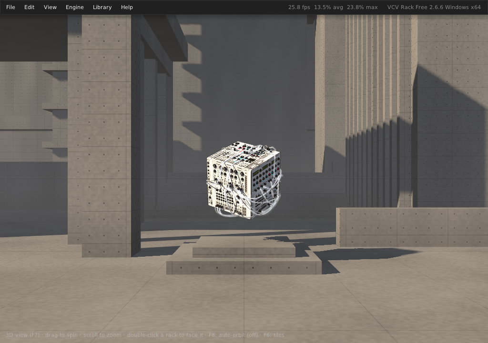
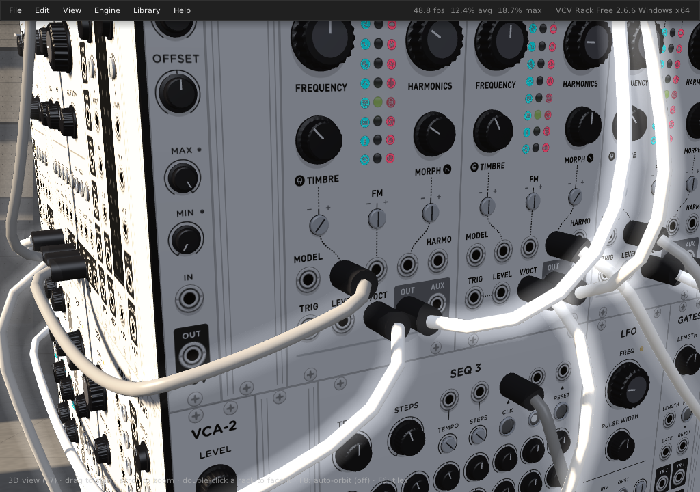
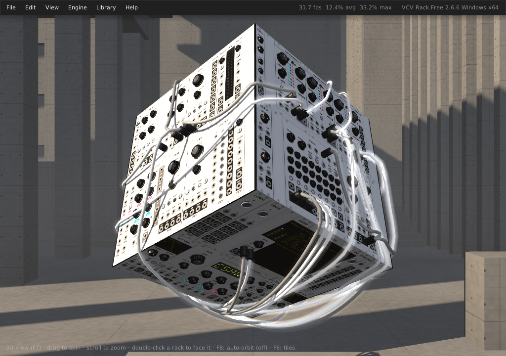
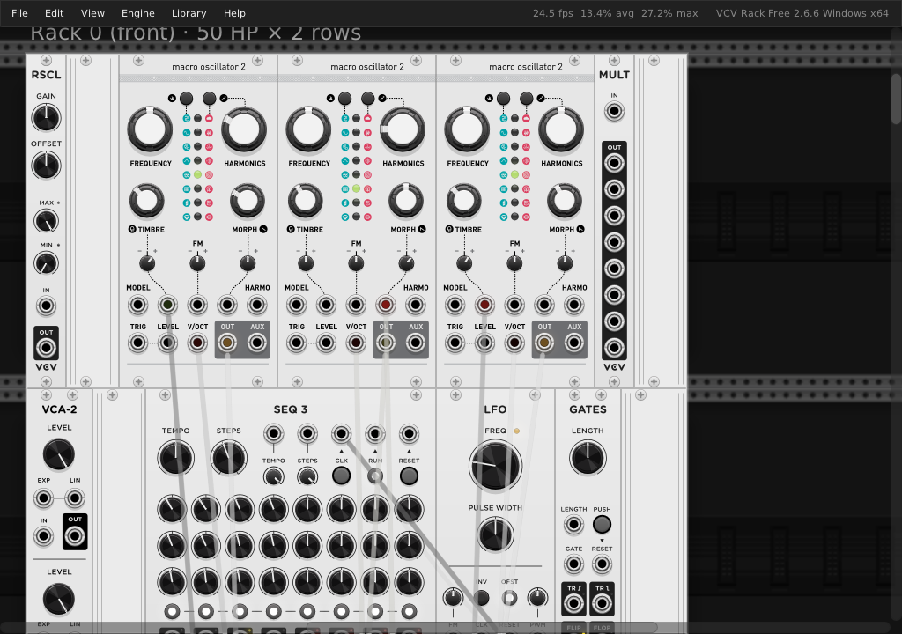

# Rack 3D

*Rack 3D* is an experimental fork of [VCV Rack](https://github.com/VCVRack/Rack) Free 2.6.6. Your modules live on the faces of a 3D object, and cables are physical ropes that hang, sag, bounce and wrap around its edges as you turn it.

It is an unofficial, hobby fork. It is not made, endorsed or supported by VCV. "VCV" and "VCV Rack" are trademarks of VCV; please send questions about this fork here, not to VCV Support.

https://github.com/user-attachments/assets/94b58f96-ea41-42f4-a8ec-ca950a1272cf

*The chord drone patch (`examples/chord-drone.vcv`) playing, sound on. The cube spins in the concrete plaza with its cables swinging and the sun's shadows moving across it, then the view zooms in to turn the 3D knobs on the Plaits voices.*

| | |
|---|---|
|  |  |
|  |  |

### Bloom

Bloom, the spectral flower module (one of the [3D modules](#3d-modules)). Its petals open and close with each frequency band of the drone, over leaves that sway with the bass:

https://github.com/user-attachments/assets/f14c12c9-933c-4818-a129-49bb46f56b65

## What's different from VCV Rack

### Racks on a 3D object

- **Rack placements.** The single infinite rack is divided into *racks*: blocks of grid rows, each mapped onto a flat surface of a 3D model. The default model is a cube with one rack of 2 rows × 50 HP on each face.
  - Modules must sit inside a rack. Adding, dragging or pasting modules finds the nearest free spot, and patches made in stock Rack are fitted into the racks when they load.
  - The layout is saved in the patch under a `"rack3d"` key. Module positions are ordinary Rack grid positions, so plugins and undo history work unchanged.
  - On by default. Turn it off and on with View → Rack 3D → Rack placements.
- **3D view (F7).** Shows the model with every rack live on its surface, and you play it there.
  - Knobs, ports, context menus, and module and cable dragging all work in 3D: mouse events are ray-cast onto the racks and handed to the normal rack widgets.
  - Drag empty space to spin the model; it keeps spinning when you let go.
  - Scroll to zoom, and double-click a rack to turn it to face you.
- **Auto-orbit (F8).** Slowly turns and tips the model so every face comes round, including the top and bottom. It pauses while you use the view.
- **Tiles view (F6).** Shows every rack's texture side by side, for debugging.

### Physical cables

- In the 3D view, cables are simulated ropes in world space (Verlet integration with stretch and bend constraints). They sag under gravity and swing when you turn the model. They also collide with it, with real thickness, so they wrap around corners instead of cutting through.
- Plugs sit in their jacks, facing out of the panel. A cable you're dragging dangles from the pointer in 3D.
- Every physics parameter can be tuned live in View → Rack 3D → Cable physics.

### 3D controls

- 3D knobs stand over the 2D knobs and turn with them. Knobs are drawn differently by size: silver trimpots, small and medium black knobs, and large gripped knobs with a cap.
- Slider handles, push buttons, light buttons and toggle switches are also drawn in 3D and follow the module's state.

### 3D modules

Modules can have parts that stand out of the panel in the 3D view: a display that tilts up, a flap, petals, leaves. Two come built in, in the Core plugin, and any plugin can make its own.

#### Bloom

A spectral flower that dances to whatever you feed it.

- **Sound:**
  - The stereo input is split into six bands: bass, low, low mid, mid, presence and air (90 Hz to 7.2 kHz).
  - Each band has an envelope follower.
  - Audio passes through to the outputs untouched, polyphonic too, so Bloom can sit at the end of a patch.
- **3D:**
  - Six outer petals, plus six inner ones between them, surround a hub that floats above the panel. Each petal follows one band.
  - A quiet band's petals lean in and curl over the hub as a closed bud. As the band gets louder they open out, flare their tips and brighten until they glow.
  - Six toothed, veined leaves underneath droop at the tips, sway, and lift with the bass.
  - Everything is lit and casts shadows.
- **2D:** the flat rack shows the flower from above, opening the same way.
- **Controls:**

  | Control | What it does |
  |---|---|
  | SENSE | Input sensitivity, −12 to +30 dB before the bands are measured |
  | RELEASE | How fast petals close again, 50 ms to 1.5 s |
  | REST | How open the petals stay in silence |
  | HUE | The petals' colours; each band follows around the colour wheel |
  | IN L / IN R | Audio in (R follows L when unpatched) |
  | OUT L / OUT R | The same audio, passed through |
  | BAND LEVELS | Each band's level as 0–10 V CV, a six-band envelope follower for the rest of the patch |

  The levels are measured over a 30 dB window, so a full mix still opens some petals more than others.

#### 3D Tester

A small test module for the 3D element system: a display hinged above its knobs, showing a scrolling sine wave.
- ANGLE swings it from flat on the panel to almost straight out.
- CYCLES and HUE change the wave.
- `tests/rack3d/tester3d.vcv` has four at different settings.

#### Making your own: `rack3d::Element3D`

`rack3d::Element3D` is a widget, available to any plugin through `<rack.hpp>`. Add it to your `ModuleWidget` like any other widget and draw its content with NanoVG.

- **In the 2D rack** it draws flat in its box, so the module works everywhere.
- **In the 3D view** it's taken out of the rack's texture and drawn on its own surface. That surface is hinged to the panel along one edge of the element's box, then swung, turned and bent by the properties below.
- **Updates:** the content is redrawn every frame, and you can change the properties in `step()`, for instance from a knob or the module's state.

```cpp
struct Flap : rack3d::Element3D {
	MyModule* module = NULL;

	Flap() {
		hinge = HINGE_BOTTOM;  // swings out around its bottom edge
		cup = 0.6f;            // curved across its width, like a scoop
	}

	void step() override {
		// Open the flap with a knob: flat at 0, standing straight out at 1
		if (module)
			tilt = module->params[MyModule::OPEN_PARAM].getValue() * M_PI / 2;
		Element3D::step();
	}

	void drawContent(const DrawArgs& args) override {
		// NanoVG drawing in the box's coordinates, as in any widget's draw()
	}
};

// In the ModuleWidget's constructor:
Flap* flap = new Flap;
flap->module = module;
flap->box = math::Rect(10, 60, 100, 80);
addChild(flap);
```

| Property | What it does |
|---|---|
| `hinge` | Which edge of the box is fixed to the panel: `HINGE_BOTTOM`, `HINGE_TOP`, `HINGE_LEFT` or `HINGE_RIGHT` |
| `tilt` | How far it swings out of the panel, radians: 0 lies flat, π/2 stands straight out, more leans back over the panel |
| `angle` | Turns it in the panel's plane around the middle of its hinge, radians, clockwise. Use it to point elements in any direction, as Bloom's petals do around a circle |
| `lift` | Raises the hinge off the panel, in panel pixels. With `tilt` 0 the element floats above the panel, like Bloom's hub |
| `curl` | Bends it along its length, radians in all: positive toward the side its content faces, negative away |
| `cup` | Bends it across its width, radians: positive raises the side edges toward its front |
| `flatIn2D` | Set false to leave it out of the 2D rack, for parts that only make sense in 3D. Draw a 2D stand-in yourself; `rack3d::isDrawingRackTextures()` tells you when not to |
| `resolution` | Texture pixels per panel pixel in 3D, default 2. Raise it for small text |
| `drawContent()` | Override to draw the content; the default draws the element's children |

Some details worth knowing:
- **Rendering:** the element is lit, shadowed, fogged and seen from both sides. Transparent pixels in its drawing are cut out, so its shape can be anything you draw.
- **Bending:** a bent element (`curl` or `cup`) is drawn as a finely subdivided curved surface with smooth lighting.
- **Glow:** bright, strongly coloured pixels glow slightly, like LEDs.
- **Clicks:** in the 3D view they go to the panel behind an element, so the element itself can't be clicked yet. Cables don't collide with elements.

### Scene

- The model floats in a sunken plaza of giant brutalist concrete structures. The concrete is shaded procedurally, with plank seams, form-panel joints, tie holes and rain streaks.
- **Lighting:**
  - Lighting is computed in linear color.
  - A low sun casts shadows from two shadow-map cascades: a sharp one around the model (knobs and cables shadow the panels) and a wide one for the buildings.
  - A soft fill light from the camera side, sky and ground ambient, and specular highlights complete it.
- **Fog:**
  - Height fog pools near the ground and starts behind the model, so the modules stay crisp at any zoom.
  - Light shafts are marched through the shadow map.
- **Glow:** cables give off a soft glow, and panel LEDs and displays give off a little light of their own.
- The settings are in View → Rack 3D → Scene:

  | Setting | What it does |
  |---|---|
  | Concrete plaza, sun and fog | Turns the environment on or off. Off is the plain dark background. |
  | Fog | How thick the haze and light shafts are. |
  | Cable glow | How much the cables glow. |
  | Contrast | Darkens shade and haze and brightens the sun. Glowing things stay bright. |
  | Orbit speed | How fast auto-orbit turns. |

### Renderer

- Rack 3D renders with an **OpenGL 4.5 core profile** context and NanoVG's GL3 backend; upstream Rack uses OpenGL 2. The 3D view draws into a multisampled offscreen target that is composited into the normal NanoVG frame.
- Plugins that draw only with NanoVG (nearly all of them) work unchanged. Plugins that make legacy fixed-function OpenGL calls of their own will not work in a core profile.

### Developer tools

- `RACK3D_TOOL=dump|preview|devices` runs a tool instead of the normal window. `scripts/rack3d-tool.sh` wraps all three; see `include/rack3d/Tools.hpp`.
  - `dump` writes every module's ports and parameters as JSON, so patches can be written by script.
  - `preview` loads a patch, checks that every module and cable loaded and sits in a rack, logs each module's output level, and saves screenshots. With `RACK3D_TOOL_FOCUS=<module slug>` it also turns that module's rack to face the camera, takes close-ups, and logs the module's outputs. This is handy for checking a module's 3D elements.
  - `devices` lists the audio devices.
- Tests:
  - `tests/rack3d/run.sh` runs the unit tests (layout, cable physics, math).
  - `tests/rack3d/run-app.sh` runs an in-app self-test of about 150 checks against the live rack, with real modules, rendering and input.
- `examples/chord-drone.vcv` is a six-voice chord drone over all six faces, made with Mutable Instruments (Audible Instruments), Fundamental and Valley Plateau. `scripts/make_chord_drone.py` generates it.

### Not done yet

- The only model is the cube. Loading other 3D models and placing racks on their flat surfaces is the long-term goal.
- 3D elements are textured surfaces, flat or bent. Whole mesh faceplates, and elements you can click in 3D, are planned.
- It has only been built and tested on **Windows** (MSYS2). macOS cannot run it: macOS supports at most OpenGL 4.1. Linux should work with a GL 4.5 driver, but is untested.

## Download

Windows builds are on the [Releases](https://github.com/math0ne/rack-3d/releases) page. Each one is a portable zip:

1. Unzip it anywhere.
2. Run `Rack.exe`. Nothing needs to be installed.
3. Press **F7** for the 3D view.

You need a GPU and driver with OpenGL 4.5.

Rack 3D keeps its settings, plugins and autosave in its own user folder, `%LOCALAPPDATA%\Rack3D`. It never reads or moves stock VCV Rack's `Rack2` folder, so the two can be installed side by side. Only one of them can run at a time, as with two copies of upstream Rack. Log in from the Library menu to install plugins.

Releases are built by GitHub Actions from version tags; see [Releases](#releases) below.

## Building

Building is the same as [upstream's instructions](https://vcvrack.com/manual/Building), with these differences:

- You need a GPU and driver with **OpenGL 4.5**.
- Clone this repository instead of VCVRack/Rack.
- Only the Windows build is tested.

### Windows (MSYS2 MINGW64)

1. Install [MSYS2](https://www.msys2.org/), open the **MINGW64** shell, and update it. Run this twice; the first pass may only update the core packages and close the shell.

```bash
pacman -Syu
```

2. Install the toolchain.

```bash
pacman -S --needed git wget make tar unzip zip autoconf automake libtool python zstd jq mingw-w64-x86_64-gcc mingw-w64-x86_64-gdb mingw-w64-x86_64-cmake mingw-w64-x86_64-pkgconf
```

3. Clone with submodules, build the dependencies (slow, run once), then build Rack.

```bash
git clone --recursive https://github.com/math0ne/rack-3d.git Rack
cd Rack
make dep -j$(nproc)
make -j$(nproc)
```

4. Build the Fundamental plugin into `plugins/`. The tests and the example patch use it.

```bash
git clone --recursive https://github.com/VCVRack/Fundamental.git plugins/Fundamental
make -C plugins/Fundamental dep
make -C plugins/Fundamental -j$(nproc)
```

### Running

- **Development mode:** `./Rack -d` (or `make run`) loads plugins from `plugins/` and logs to the terminal. As in upstream, the VCV Library is disabled in this mode.
- **Normal mode, with the Library:** run `scripts\Rack3D.bat` from Windows, optionally with a patch, for example `scripts\Rack3D.bat examples\chord-drone.vcv`.
  - It runs Rack with the user folder `userdata\` in the checkout, separate from a release's `%LOCALAPPDATA%\Rack3D`.
  - On first run it copies Fundamental in.
  - Log in from the Library menu to install plugins.
- **Runtime DLLs:** `Rack.exe` needs MinGW's runtime DLLs (`libgcc_s_seh-1.dll`, `libstdc++-6.dll`, `libwinpthread-1.dll`) from `C:\msys64\mingw64\bin`. `Rack3D.bat` puts that folder on `PATH`. If you start `Rack.exe` another way, add it yourself.
- **Opening the 3D view:** press **F7** (or View → Rack 3D). Only one Rack instance can run at a time, as in upstream.

### Packaging

`make dist DIST_HTML=` gathers a runnable folder in `dist/`:
- `Rack.exe` and `libRack.dll` (stripped),
- the resources,
- MinGW's runtime DLLs,
- the Fundamental plugin package, which Rack installs into the user folder on first run.

`DIST_HTML=` skips the HTML copies of the docs, which need a `markdown` tool. Upstream's `make package` NSIS installer is not used, because it would install over VCV Rack 2 Free.

### Releases

Builds run on GitHub Actions (`.github/workflows/build.yml`) only for releases, not for every push. A build:
- builds on Windows in MSYS2, caching the built dependencies,
- runs the unit tests,
- packages `Rack3D-<version>-win-x64.zip`.

To release, run the self-tests, push your commits to `main`, then tag. `scripts/release.sh` checks that the working tree is clean and the commit is already on GitHub's `main`, shows the changes since the last release, and pushes an annotated tag:

```bash
bash scripts/release.sh --dry-run v0.1.0
```

```bash
bash scripts/release.sh v0.1.0
```

The tag starts the build, which publishes the zip as a GitHub release with generated notes. A version with a hyphen, such as `v0.2.0-beta.1`, is published as a pre-release. Rack 3D's versions are its own and count from `v0.1.0`; the upstream `v2.x` tags in a VCV Rack checkout are ignored.

To build without releasing, use **Run workflow** on the [Build workflow's page](https://github.com/math0ne/rack-3d/actions/workflows/build.yml). The zip is kept as an artifact of that run.

The in-app self-test needs a real OpenGL 4.5 GPU, which GitHub's runners don't have, so run it locally before tagging.

### Tests

From the MINGW64 shell in the checkout, after `make`:

```bash
bash tests/rack3d/run.sh
```

```bash
bash tests/rack3d/run-app.sh
```

The in-app test opens a window briefly and uses a throwaway user folder.

## License

Same as upstream: Rack's source code is GPLv3. See [LICENSE.md](LICENSE.md) for the full terms, including the components under other licenses. The upstream credits below are kept as they were.

---

## Upstream: VCV Rack

*Rack* is the host application for the VCV virtual Eurorack modular synthesizer platform.

- [VCV website](https://vcvrack.com/)
- [Manual](https://vcvrack.com/manual/)
- [Module Library](https://library.vcvrack.com/)
- [Rack source code](https://github.com/VCVRack/Rack)
- [Building](https://vcvrack.com/manual/Building)
- [Communities](https://vcvrack.com/manual/Communities)

### Acknowledgments

- [Andrew Belt](https://github.com/AndrewBelt): Lead Rack developer
- [Pyer](https://www.pyer.be/): Module design, component graphics
- [Richie Hindle](http://entrian.com/audio/): Rack developer, bug fixes
- [Grayscale](https://grayscale.info/): Module design, branding
- Christoph Scholtes: [Library reviews](https://github.com/VCVRack/library) and [plugin toolchain](https://github.com/VCVRack/rack-plugin-toolchain)
- Translators
	- German: Stephan Müsch, Norbert Denninger
	- Spanish: Kevin U. Cano Guerra, Coriander V. Pines
	- French: Pyer
	- Italian: Alessandro Paglia
	- Chinese (Simplified): NoiseTone
	- Japanese: [Leo Kuroshita](https://x.com/kurogedelic)
- Rack plugin developers: Authorship shown on each plugin's [VCV Library](https://library.vcvrack.com/) page

### Dependency libraries

- [GLFW](https://www.glfw.org/)
- [GLEW](http://glew.sourceforge.net/)
- [NanoVG](https://github.com/memononen/nanovg)
- [NanoSVG](https://github.com/memononen/nanosvg)
- [oui-blendish](https://hg.sr.ht/~duangle/oui-blendish)
- [osdialog](https://github.com/AndrewBelt/osdialog) (written by Andrew Belt for VCV Rack)
- [ghc::filesystem](https://github.com/gulrak/filesystem)
- [Jansson](https://digip.org/jansson/)
- [libcurl](https://curl.se/libcurl/)
- [OpenSSL](https://www.openssl.org/)
- [Zstandard](https://facebook.github.io/zstd/) (for Rack's `.tar.zstd` patch format)
- [libarchive](https://libarchive.org/) (for Rack's `.tar.zstd` patch format)
- [PFFFT](https://bitbucket.org/jpommier/pffft/)
- [libspeexdsp](https://gitlab.xiph.org/xiph/speexdsp/-/tree/master/libspeexdsp) (for Rack's fixed-ratio resampler)
- [libsamplerate](https://github.com/libsndfile/libsamplerate) (for Rack's variable-ratio resampler)
- [RtMidi](https://www.music.mcgill.ca/~gary/rtmidi/)
- [RtAudio](https://www.music.mcgill.ca/~gary/rtaudio/)
- [Fuzzy Search Database](https://bitbucket.org/j_norberg/fuzzysearchdatabase) (written by Nils Jonas Norberg for VCV Rack's module browser)
- [TinyExpr](https://codeplea.com/tinyexpr) (for math evaluation in parameter context menu)
